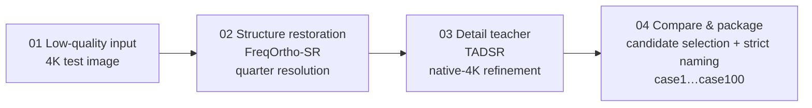
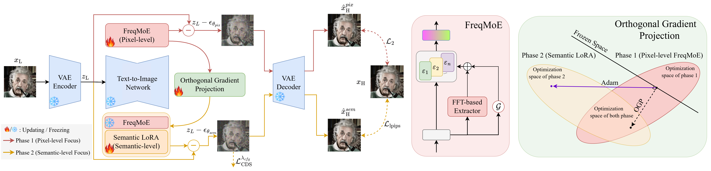
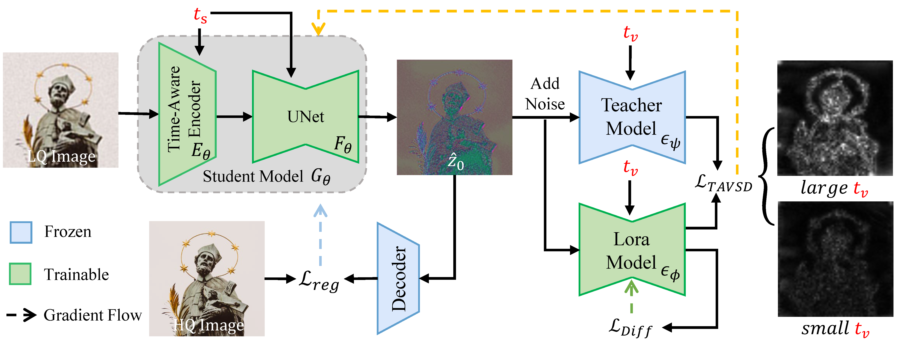

# Clarity with Restraint, Enhancement under Control

<p align="center">
  <a href="README.md"></a>
  <a href="README.en.md"></a>
</p>

> [!IMPORTANT]
> **In one sentence**: a two-stage generative enhancement pipeline built on **FreqOrtho-SR + TADSR** — FreqOrtho-SR preserves pixel structure at quarter resolution (FreqMoE frequency routing + OGP orthogonal gradient projection), TADSR's time-aware one-step diffusion refines the result back to native 4K, and an interpretable weighted rule performs candidate selection. Restore structure first, refine details second, close out with interpretability.
>
> **Results**: 2026 CSIG "Camera Academic Star" Track 1 · Preliminary official record **4.0003** · top-5 candidates: case **44 / 60 / 97 / 79 / 51** · **end-to-end on a single A100 40GB**
>
> **How to run**: source, weights, inference scripts and the official result package all ship with this repository ([`work/`](work/)). One-command Docker reproduction:
>
> ```bash
> docker compose build && docker compose run --rm freqortho-sr
> ```
>
> Five-step details in [work/RUNBOOK.md](work/RUNBOOK.md); base-model sources and image notes in [🐳 Docker Reproduction](#docker-reproduction).


<p align="center"></p>

> Demo sequence: case22 / case43 / case51 / case56 / case60 / case97 — left: low-quality input from `data/测试集`, right: official submitted result from `work/05_official_package`. Both sides ship with the repository and can be verified frame by frame.

---

## 🏆 Results at a Glance

| Item | Result |
|------|--------|
| Preliminary official record | **4.0003** (100 / 100 4K results submitted and packaged, with SHA-256 checksums) |
| Official-record top-5 candidates | case **44 · 60 · 97 · 79 · 51** |
| FreqOrtho-SR · DRealSR benchmark | PSNR **29.08** / LPIPS **0.2799** (both improved simultaneously) |
| Hardware requirement | Entire pipeline on a **single A100 40GB** |

## 📖 The Challenge

The task requires enhancing 4K low-quality images with a **Diffusion-based** model, scored against hidden Ground Truth by a weighted combination of full-reference and no-reference metrics. The hard part is not upscaling — it is staying faithful while getting sharper.

**Four hard constraints:** clarity improvement · content consistency · resolution preservation · natural color and structure

**Five challenge scenarios:** small faces · text · dense vegetation · clocks · birds

## 🧩 Solution Overview



One engineering throughline: **pixel structure is guarded by FreqMoE, semantic detail is supplied by TADSR, and the final output returns to a unified 4K geometry.**

### FreqOrtho-SR: Splitting "sharp" and "faithful" into controllable directions

Core idea: **learn pixel fidelity and semantic awareness separately, then use an orthogonality constraint to keep them from interfering with each other.**

- **FreqMoE** — routes FFT-based degradation features to pixel-level LoRA experts, first judging which kind of degradation the input resembles;
- **OGP (Orthogonal Gradient Projection)** — extracts the pixel subspace via SVD and projects the semantic-LoRA gradients onto its null space, so the two optimization directions never drag at each other.



### TADSR: Guarding 4K detail with time-aware one-step diffusion

TADSR does not reinvent content — it **refines the coarsely restored result onto a more natural 4K surface**.

- Time-aware encoder + student model (UNet + LoRA);
- Frozen teacher model provides detail constraints (TAVSD distillation);
- High/low timesteps adapt to complex 4K scenes: **t=500 for ordinary cases, t=800 for complex cases flagged in scene_4k.json**.



## ⚙️ End-to-End Engineering Loop

| Stage | Content |
|-------|---------|
| Prepare | Generate quarter-resolution inputs |
| Restore | FreqOrtho-SR one-step inference |
| Refine | TADSR teacher refinement to native 4K (t=500 / 800) |
| Compare | Candidate selection: `utility = 1.10286 × d_nr4 + 0.21747 × d_edge` |
| Package | Uniformly named output `output_dir/case1.jpg … case100.jpg` |

The selection weights come from a full-100 teacher-vs-candidate comparison experiment (`work/03_pipeline/config/freq_teacher_vs_plus3_full100_1024.json`) — an **interpretable, auditable** rule rather than a black-box score.

## 📦 Reproduction (work/)

### What ships with the repository

| Item | Status | Location |
|------|--------|----------|
| FreqOrtho-SR fine-tuned weights `freqortho_sr.pkl` (57.7MB) | ✅ included | `work/01_freqortho_sr/weights/` |
| TADSR LoRA weights (`tadsr_imag2006_a15.pkl` etc.) | ✅ included | `work/02_tadsr/weights/` |
| Inference / compare / select / package scripts & config | ✅ included | `work/03_pipeline/` |
| Test inputs (case1…case100, 4K) and validation set | ✅ included | `data/` |
| Official 4.0003 result package (100 4K images) | ✅ included | `work/05_official_package/` |
| **SD2.1-base / RAM / TADSR base models** | ❌ not included | see [🐳 Docker Reproduction](#docker-reproduction) |

### Directories

| Directory | Contents |
|-----------|----------|
| `work/01_freqortho_sr/` | Complete FreqOrtho-SR source + `freqortho_sr.pkl` weights |
| `work/02_tadsr/` | TADSR source + LoRA weights |
| `work/03_pipeline/` | Inference / compare / select / package scripts + config (`scene_4k.json` etc.) |
| `work/04_environment/` | Dual-environment dependency manifests (Conda + pip, incl. base-model notes) |
| `work/05_official_package/` | Official 4.0003 submission package: `output_dir/case1.jpg … case100.jpg` |
| `work/06_defense/` | Defense materials |

<details>
<summary><b>Five-step reproduction (click to expand; details in <a href="work/RUNBOOK.md">work/RUNBOOK.md</a>)</b></summary>

1. Generate quarter-resolution inputs — `pipeline/prep_freqortho_full100.py`
2. Patch and run FreqOrtho-SR one-step inference (`--process_size 512 --upscale 4`)
3. TADSR teacher refinement back to native 4K — t=500 for ordinary cases, t=800 for complex cases in `scene_4k.json`; teacher Gaussian blur r=3.0 + ADain color correction
4. Candidate selection `utility = 1.10286 × d_nr4 + 0.21747 × d_edge` — official top-5: **44 / 60 / 97 / 79 / 51**
5. Rebuild the submission package — only the 5 selected entries are replaced; the other 95 remain byte-identical to the opt7 4.0002 baseline

</details>

<details>
<summary><b>Pinned environments (two separate environments, must not be merged — click to expand)</b></summary>

| | FreqOrtho-SR | TADSR |
|---|---|---|
| Python | 3.10 | 3.10 |
| Torch / torchvision | 2.9.1 / 0.24.1 | 2.0.1 |
| transformers | 4.37.2 | 4.28.1 |
| diffusers | 0.25.0 | 0.25.0 |
| Others | xformers 0.0.33.post2 | xformers 0.0.20, peft 0.9.0 |

Source: [work/04_environment/ENVIRONMENT.md](work/04_environment/ENVIRONMENT.md); the conda env file and pip manifests live in the same directory.

</details>

> Official result package SHA-256: `8e24ea7a06dddeb7ab92322ee48bf4245d05023d9bb6ed629d81e791196d1a35` (matches the record in [work/SOURCE_FILES.md](work/SOURCE_FILES.md)).

## 🐳 Docker Reproduction

The two pinned environments **must not be merged** ([ENVIRONMENT.md](work/04_environment/ENVIRONMENT.md) explicitly warns about torch/xformers conflicts), so they are packaged as two images; fine-tuned weights and inference scripts are baked into the images, while the **three base models ship with neither the repository nor the images** — obtain them per [work/00_README.md](work/00_README.md) and each README's official source, then place them in `./models-base/` (auto-mounted as `/opt/base-models` inside the containers):

| Base model | Official source | Purpose |
|------------|-----------------|---------|
| Stable Diffusion 2.1-base | [stabilityai/stable-diffusion-2-1-base](https://huggingface.co/stabilityai/stable-diffusion-2-1-base) | FreqOrtho-SR base (`preset/models/SD21`) |
| RAM `ram_swin_large_14m.pth` | [Recognize Anything](https://huggingface.co/spaces/xinyu1205/recognize-anything) | automatic semantic prompting |
| TADSR base | [zty557/TADSR](https://huggingface.co/zty557/TADSR) | teacher refinement |

```bash
# Build (freqortho-sr ≈ 6–8 GB incl. cu12.8 runtime libs; tadsr ≈ 4–5 GB; first build downloads dependencies)
docker compose build

# Enter the containers interactively and follow the five steps in work/RUNBOOK.md
# (adjust hardcoded script paths as noted in the RUNBOOK)
docker compose run --rm freqortho-sr    # steps 1–2, 4–5: prep / FreqOrtho-SR / selection / packaging
docker compose run --rm tadsr           # step 3: TADSR teacher native-4K refinement
```

> ⚠️ **Honest note**: the archiving machine has neither Docker nor an NVIDIA GPU — image builds and GPU inference are **untested**; the Dockerfiles follow the pinned manifests in `work/04_environment/` (freqortho follows the yaml "reconstructed environment"; its difference from the legacy `requirements-freqortho.txt` is documented in the header of [docker/requirements-freqortho.txt](docker/requirements-freqortho.txt)). Running requires Docker + NVIDIA Container Toolkit; drivers: ≥ 525.60 for the cu12.8 image, ≥ 450.80 for the cu118 image.

## 🎯 How Controllability Lands on the Five Challenge Scenarios

The same generative pipeline keeps different detail boundaries for different degradation types:

| Scenario | Control principle |
|----------|-------------------|
| Small faces | Preserve identity structure; never invent a new face |
| Text | Guard stroke topology first, then sharpen edges |
| Dense vegetation | Suppress repeated textures and over-sharpening |
| Clocks | Preserve dial markers, hands, and circular structure |
| Birds | Recover feather boundaries without fabricating plumage |

Result-image evidence from the official package (case attribution verified against the test set by content matching):

| Text (case22 crop) | Dense vegetation (case56) | Clock (case43) | Bird (case60) |
|:---:|:---:|:---:|:---:|
|  |  |  |  |

> In the text image, the "香樟" sign strokes, QR code, leaf veins, the clock's Roman markers, and the feather boundaries all stay natural — no repainting or artifact traces.

## ✅ Submission Compliance

- ✅ Only result images inside `output_dir` are submitted
- ✅ `case1.jpg … case100.jpg` strictly matched to test inputs
- ✅ No CJK punctuation in filenames; validation set excluded
- ✅ Outer `.zip` ≤ 10GB
- ✅ Result package ships with a SHA-256 manifest for audit

## 📂 Repository Structure

```
.
├── README.md                    # Chinese original of this document
├── README.en.md                 # English version
├── 赛题介绍.md                   # original competition brief (Chinese)
├── requirements.txt
├── docker-compose.yml           # dual-image Docker orchestration
├── .dockerignore
├── docker/                      # Docker reproduction
│   ├── Dockerfile.freqortho_sr  # structure-restoration image (torch 2.9.1+cu12.8)
│   ├── Dockerfile.tadsr         # TADSR teacher image (torch 2.0.1+cu118)
│   └── requirements-freqortho.txt
├── data/
│   ├── 测试集/                  # case1 … case100 (4K inputs)
│   └── 验证集/                  # 5 aligned LQ/GT pairs
├── assets/                      # figures for this document (architecture / evidence / demo GIF)
├── work/                        # full reproduction kit
│   ├── 00_README.md             # bundle index
│   ├── RUNBOOK.md               # five-step 4.0003 reproduction runbook
│   ├── SOURCE_FILES.md          # provenance declaration of original files
│   ├── 01_freqortho_sr/         # FreqOrtho-SR source + weights
│   ├── 02_tadsr/                # TADSR source + LoRA weights
│   ├── 03_pipeline/             # inference scripts & config
│   ├── 04_environment/          # environment manifests
│   ├── 05_official_package/     # official 4.0003 result package (100 images)
│   └── 06_defense/              # defense materials
└── 杂/                           # original zip bundles archive (zips not tracked)
```

## 🙏 Acknowledgements & Declaration

- The solution builds on **FreqOrtho-SR** (FreqMoE + orthogonal gradient projection) and **TADSR** (time-aware one-step diffusion distillation); third-party models and pretrained weights will be explicitly declared in the finals originality materials.
- Competition data is owned by the organizers, used here solely for this competition — no commercial or academic publication use.
- This repository is currently **private**.
