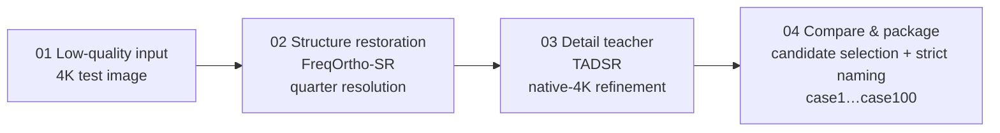

# Clarity with Restraint, Enhancement under Control

**English** | [简体中文](README.md)


-EA580C)


> [!IMPORTANT]
> **In one sentence**: a two-stage generative enhancement pipeline built on **FreqOrtho-SR + TADSR** — FreqOrtho-SR preserves pixel structure at quarter resolution (FreqMoE frequency routing + OGP orthogonal gradient projection), then TADSR's time-aware one-step diffusion refines the result back to native 4K, and an interpretable weighted rule performs candidate selection. **Preliminary official record: 4.0003** (100/100 4K results packaged with strict naming and SHA-256), **end-to-end on a single A100 40GB**.
>
> **Where to look**: [Overview](#solution-overview) (two architecture diagrams) · [Evidence on five challenge scenarios](#how-controllability-lands-on-the-five-challenge-scenarios) · [End-to-end engineering loop](#end-to-end-engineering-loop)
>
> **How to run**: the validation set (5 LQ/GT pairs) and the test set (case1…case100, 4K) ship with this repository for direct inspection and re-evaluation; the full inference toolkit (RUNBOOK, scripts, scene_4k.json, result package) lives in the primary workspace and will be archived here.

---

**2026 CSIG "Camera Academic Star" Imaging Algorithm Competition · Track 1: Controllability of Generative Image Enhancement · Finals solution**

## Results at a Glance

| Item | Result |
|------|--------|
| Preliminary official record | **4.0003** (100 / 100 4K results submitted and packaged, with SHA-256 checksums) |
| Official-record top-5 candidates | case **44 · 60 · 97 · 79 · 51** |
| FreqOrtho-SR · DRealSR benchmark | PSNR **29.08** / LPIPS **0.2799** (both improved simultaneously) |
| Hardware requirement | Entire pipeline on a **single A100 40GB** |

## The Challenge

The task requires enhancing 4K low-quality images with a **Diffusion-based** model, scored against hidden Ground Truth by a weighted combination of full-reference and no-reference metrics. The hard part is not upscaling — it is staying faithful while getting sharper.

**Four hard constraints:** clarity improvement · content consistency · resolution preservation · natural color and structure

**Five challenge scenarios:** small faces · text · dense vegetation · clocks · birds

## Solution Overview



One engineering throughline: **pixel structure is guarded by FreqMoE, semantic detail is supplied by TADSR, and the final output returns to a unified 4K geometry.**

### FreqOrtho-SR: Splitting "sharp" and "faithful" into controllable directions

Core idea: **learn pixel fidelity and semantic awareness separately, then use an orthogonality constraint to keep them from interfering with each other.**

- **FreqMoE** — routes FFT-based degradation features to pixel-level LoRA experts, first judging which kind of degradation the input resembles;
- **OGP (Orthogonal Gradient Projection)** — extracts the pixel subspace via SVD and projects the semantic-LoRA gradients onto its null space, so the two optimization directions never drag at each other.


### TADSR: Guarding 4K detail with time-aware one-step diffusion

TADSR does not reinvent content — it **refines the coarsely restored result onto a more natural 4K surface**.

- Time-aware encoder + student model (UNet + LoRA);
- Frozen teacher model provides detail constraints (TAVSD distillation);
- High/low timesteps adapt to complex 4K scenes: **t=500 for ordinary cases, t=800 for complex cases flagged in scene_4k.json**.


## End-to-End Engineering Loop

| Stage | Content |
|-------|---------|
| Prepare | Generate quarter-resolution inputs |
| Restore | FreqOrtho-SR one-step inference |
| Refine | TADSR teacher refinement to native 4K (t=500 / 800) |
| Compare | Candidate selection: `utility = 1.10286 × d_nr4 + 0.21747 × d_edge` |
| Package | Uniformly named output `output_dir/case1.jpg … case100.jpg` |

The selection weights come from a full-100 teacher-vs-candidate comparison experiment (`freq_teacher_vs_plus3_full100_1024.json`) — an **interpretable, auditable** rule rather than a black-box score.

## How Controllability Lands on the Five Challenge Scenarios

The same generative pipeline keeps different detail boundaries for different degradation types:

| Scenario | Control principle |
|----------|-------------------|
| Small faces | Preserve identity structure; never invent a new face |
| Text | Guard stroke topology first, then sharpen edges |
| Dense vegetation | Suppress repeated textures and over-sharpening |
| Clocks | Preserve dial markers, hands, and circular structure |
| Birds | Recover feather boundaries without fabricating plumage |

Result-image evidence from the official package (case attribution verified against the test set by content matching):

| Text (case22 crop) | Dense vegetation (case56) | Clock (case43) | Bird (case60) |
|:---:|:---:|:---:|:---:|
|  |  |  |  |

> In the text image, the "香樟" sign strokes, QR code, leaf veins, the clock's Roman markers, and the feather boundaries all stay natural — no repainting or artifact traces.

## Submission Compliance

- ✅ Only result images inside `output_dir` are submitted
- ✅ `case1.jpg … case100.jpg` strictly matched to test inputs
- ✅ No CJK punctuation in filenames; validation set excluded
- ✅ Outer `.zip` ≤ 10GB
- ✅ Result package ships with a SHA-256 manifest for audit

## Repository Structure

```
.
├── README.md                    # this document (Simplified Chinese)
├── README.en.md                 # English version
├── 赛题介绍.md                   # original competition brief (Chinese)
├── requirements.txt
├── data/
│   ├── 测试集/                  # case1 … case100 (4K inputs)
│   └── 验证集/                  # 5 aligned LQ/GT pairs
├── assets/                      # figures used by this document
└── 杂/初次.md                    # pre-competition analysis & battle plan
```

> Note: the full engineering kit (RUNBOOK, inference scripts, scene_4k.json, full-100 comparison ledger, official result package with SHA256SUMS) is maintained in the primary workspace and will be archived into this repository.

## Acknowledgements & Declaration

- The solution builds on **FreqOrtho-SR** (FreqMoE + orthogonal gradient projection) and **TADSR** (time-aware one-step diffusion distillation); third-party models and pretrained weights will be explicitly declared in the finals originality materials.
- Competition data is owned by the organizers, used here solely for this competition — no commercial or academic publication use.
- This repository is currently **private**.
