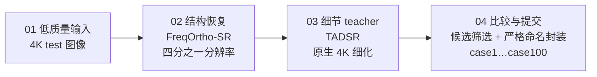

# 清晰有度，增强可控

**2026 CSIG「Camera学术之星」影像算法技术竞赛 · 赛道一：生成式图像增强可控性挑战 · 决赛方案**

> 基于 **FreqOrtho-SR + TADSR** 的两级生成式增强方案 —— 先恢复结构，再补足细节，最后用可解释的规则完成筛选。
> **全流程在单卡 A100 40GB 上完成。**

---

## 成果一览

| 项目 | 结果 |
|------|------|
| 初赛官方记录得分 | **4.0003**（100 / 100 张 4K 结果已提交封装，附 SHA-256 校验） |
| 候选筛选官方记录 top-5 | case **44 · 60 · 97 · 79 · 51** |
| FreqOrtho-SR · DRealSR 论文基准 | PSNR **29.08** / LPIPS **0.2799**（两项同时改善） |
| 硬件门槛 | 单卡 A100 40GB 完成全部推理与封装 |

## 赛题与挑战

赛题要求以 **Diffusion 架构**对 4K 低质量图像进行增强，评分对照隐藏 Ground Truth，综合多项有参考与无参考指标加权。真正难的不是放大，而是在放大后仍然保持内容真实。

**四个硬约束：** 清晰度提升 · 内容前后一致 · 分辨率保持不变 · 色彩与结构自然协调

**五类重点挑战场景：** 小人脸 · 文字 · 密集绿植 · 钟表 · 鸟类

## 方案总览



一条工程主线：**像素结构由 FreqMoE 守住，语义细节由 TADSR 补足，最终输出回到统一的 4K 几何。**

### FreqOrtho-SR：把「清晰」和「真实」拆成可控方向

核心思想：**像素保真与语义感知分开学习，再用正交约束减少相互干扰。**

- **FreqMoE** —— FFT 降质特征路由到像素级 LoRA 专家，先判断输入更像哪一种退化；
- **OGP（正交梯度投影）** —— 用 SVD 提取像素子空间，把语义 LoRA 梯度投影到其零空间，两个优化方向互不拖累。


### TADSR：用时间感知的一步扩散守住 4K 细节

TADSR 的作用不是重新发明内容，而是**把粗恢复结果细化到更自然的 4K 表面**。

- 时间感知编码器 + 学生模型（UNet + LoRA）；
- 冻结的教师模型提供细节约束（TAVSD 蒸馏）；
- 高低时间步适配复杂 4K 场景：**普通案例 t=500，复杂案例（scene_4k.json 标定）t=800**。


## 端到端工程闭环

| 阶段 | 内容 |
|------|------|
| 准备 | 生成 quarter-resolution 输入 |
| 恢复 | FreqOrtho-SR one-step 推理 |
| 细化 | TADSR teacher 细化至原生 4K（t=500 / 800） |
| 比较 | 候选筛选：`utility = 1.10286 × d_nr4 + 0.21747 × d_edge` |
| 封装 | 统一命名输出 `output_dir/case1.jpg … case100.jpg` |

筛选权重来自全量 100 张的 teacher-vs-候选对比实验（`freq_teacher_vs_plus3_full100_1024.json`），是一条**可解释、可复核**的规则，而不是黑盒打分。

## 可控性如何落到五类挑战

同一套生成式增强流程，针对不同退化类型保留不同的细节边界：

| 场景 | 控制原则 |
|------|----------|
| 小人脸 | 保留身份结构，避免凭空改脸 |
| 文字 | 先守住笔画拓扑，再提升边缘 |
| 密集绿植 | 抑制重复纹理与过度锐化 |
| 钟表 | 保持刻度、指针与圆形结构 |
| 鸟类 | 恢复羽毛边界，不制造伪羽纹 |

官方结果包中的结果图证据（按内容比对测试集确认归属）：

| 文字（case22 局部） | 密集绿植（case56） | 钟表（case43） | 鸟类（case60） |
|:---:|:---:|:---:|:---:|
|  |  |  |  |

> 文字场景图中「香樟」铭牌笔画、二维码与叶脉纹理、钟面罗马刻度、羽毛边界均保持自然，无重绘或伪影迹象。

## 提交规范达成情况

- ✅ 仅提交 `output_dir` 内的结果图
- ✅ `case1.jpg … case100.jpg` 与测试图严格对应
- ✅ 文件名不含中文符号，不混入验证集
- ✅ 外层打包 `.zip` ≤ 10GB
- ✅ 结果包附带 SHA-256 清单，可复核

## 仓库结构

```
.
├── README.md                    # 本文档
├── 赛题介绍.md                   # 赛题规则原文整理
├── requirements.txt
├── data/
│   ├── 测试集/                  # case1 … case100（4K 输入）
│   └── 验证集/                  # 5 组 LQ/GT 对齐数据
├── assets/                      # 本文档配图（PPT 内嵌图与结果证据）
└── 杂/初次.md                    # 赛前分析与作战计划
```

> 注：完整工程包（RUNBOOK、推理脚本、scene_4k.json、全量对比 ledger、官方结果包与 SHA256SUMS）在主工作区维护，后续归档至本仓库。

## 致谢与声明

- 方案基于 **FreqOrtho-SR**（FreqMoE + 正交梯度投影）与 **TADSR**（时间感知一步扩散蒸馏），引用的第三方模型与预训练权重将在决赛原创性证明材料中显著申明。
- 比赛数据所有权归主办方，仅用于本赛事，不作商用或学术发表。
- 本仓库当前为**私有**仓库。
