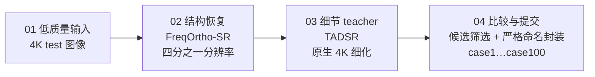

# 清晰有度，增强可控

<p align="center">
  <a href="README.md"></a>
  <a href="README.en.md"></a>
</p>

> [!IMPORTANT]
> **一句话**：基于 **FreqOrtho-SR + TADSR** 的两级生成式增强 —— FreqOrtho-SR 在四分之一分辨率守住像素结构（FreqMoE 频率路由 + OGP 正交梯度投影），TADSR 时间感知一步扩散把细节落回原生 4K，最后用可解释加权规则完成候选筛选。先恢复结构，再补足细节，可解释地收尾。
>
> **成绩**：2026 CSIG「Camera学术之星」赛道一 · 初赛官方记录 **4.0003**,排名**15/513** · 候选 top-5：case **44 / 60 / 97 / 79 / 51** · **全流程单卡 A100 40GB**
>
> **怎么跑**：公开版本包含完整源码、推理脚本与配置（[`work/`](work/)）；模型权重、答辩材料与赛题图像未随公开版本分发（见[📄 许可证](#-许可证)）。Docker 复现流程：
>
> ```bash
> docker compose build && docker compose run --rm freqortho-sr
> ```
>
> 五步细节见 [work/RUNBOOK.md](work/RUNBOOK.md)，底模获取与镜像说明见 [🐳 Docker 复现](#-docker-复现)。


[](LICENSE)

> 说明：低质量输入与官方结果输出（原仓库 `data/测试集`、`work/05_official_package/`）依赛事规则仅限赛事使用，未随公开版本分发。

---

## 🏆 成果一览

| 项目 | 结果 |
|------|------|
| 初赛官方记录得分 | **4.0003**（100 / 100 张 4K 结果已提交封装，附 SHA-256 校验） |
| 候选筛选官方记录 top-5 | case **44 · 60 · 97 · 79 · 51** |
| FreqOrtho-SR · DRealSR 论文基准 | PSNR **29.08** / LPIPS **0.2799**（两项同时改善） |
| 硬件门槛 | 单卡 A100 40GB 完成全部推理与封装 |

## 📊 性能指标

### 赛事评测

| 指标 | 结果 |
|------|------|
| 初赛官方综合得分 | **4.0003**（多指标加权，权重未公开） |
| 提交完整性 | 100 / 100 张 4K，命名严格对应 |
| 候选替换策略 | 仅替换入选 5 张，其余 95 张与 opt7 4.0002 基线字节一致 |

### 论文基准（DRealSR）

| 指标 | FreqOrtho-SR |
|------|--------------|
| PSNR | **29.08** |
| LPIPS | **0.2799** |

> 两项同时改善：像素保真（PSNR）与感知质量（LPIPS）在 DRealSR 上同向提升，印证"结构守住 + 语义补足"不互相拖累的设计目标。

### 工程与复现参数

| 项目 | 数值 / 方式 |
|------|-------------|
| 硬件 | 单卡 A100 40GB（全流程） |
| 推理范式 | FreqOrtho-SR one-step + TADSR teacher 一步细化 |
| 分辨率策略 | `--process_size 512 --upscale 4` 回到原生 4K |
| 时间步 | 常规 t=500；`scene_4k.json` 复杂场景 t=800 |
| teacher 后处理 | 高斯模糊 r=3.0 + ADain 色彩校正 |
| 候选筛选 | `utility = 1.10286 × d_nr4 + 0.21747 × d_edge`（全量 100 张对比拟合） |
| 结果包完整性 | SHA-256 清单随包分发 |

## 📖 赛题与挑战

赛题要求以 **Diffusion 架构**对 4K 低质量图像进行增强，评分对照隐藏 Ground Truth，综合多项有参考与无参考指标加权。真正难的不是放大，而是在放大后仍然保持内容真实。

**四个硬约束：** 清晰度提升 · 内容前后一致 · 分辨率保持不变 · 色彩与结构自然协调

**五类重点挑战场景：** 小人脸 · 文字 · 密集绿植 · 钟表 · 鸟类

## 🧩 方案总览



一条工程主线：**像素结构由 FreqMoE 守住，语义细节由 TADSR 补足，最终输出回到统一的 4K 几何。**

### FreqOrtho-SR：把「清晰」和「真实」拆成可控方向

核心思想：**像素保真与语义感知分开学习，再用正交约束减少相互干扰。**

- **FreqMoE** —— FFT 降质特征路由到像素级 LoRA 专家，先判断输入更像哪一种退化；
- **OGP（正交梯度投影）** —— 用 SVD 提取像素子空间，把语义 LoRA 梯度投影到其零空间，两个优化方向互不拖累。


### TADSR：用时间感知的一步扩散守住 4K 细节

TADSR 的作用不是重新发明内容，而是**把粗恢复结果细化到更自然的 4K 表面**。

- 时间感知编码器 + 学生模型（UNet + LoRA）；
- 冻结的教师模型提供细节约束（TAVSD 蒸馏）；
- 高低时间步适配复杂 4K 场景：**普通案例 t=500，复杂案例（scene_4k.json 标定）t=800**。


## 🧠 核心模块说明

### FreqOrtho-SR（`work/01_freqortho_sr/`）

| 模块 | 位置 | 职责 |
|------|------|------|
| FreqMoE（像素级） | `pisasr.py` / `train_pisasr.py` | FFT 降质特征路由到像素级 LoRA 专家 |
| OGP 正交梯度投影 | 同上 | SVD 提取像素子空间，语义 LoRA 梯度投影到零空间 |
| 推理入口 | `test_pisasr.py` | one-step 推理（`--process_size 512 --upscale 4`） |
| 微调权重 | `weights/freqortho_sr.pkl` | ❌ 未随公开版本分发（私有归档保留） |

### TADSR（`work/02_tadsr/`）

| 模块 | 位置 | 职责 |
|------|------|------|
| Time-Aware Encoder + UNet 学生 | `tadsr.py` / `train_tadsr.py` | 时间感知一步扩散学生模型 |
| LoRA 蒸馏 | `ram/models/ram_lora.py` 等 | 冻结教师约束蒸馏（TAVSD） |
| 分块推理实现 | `remote_used_sources/tadsr_tilefix.py` | 实际线上使用的 4K 分块推理 |
| 推理入口 | `test_tadsr.py` | t=500 / 800 |
| LoRA 权重 | `weights/tadsr_imag2006_a15.pkl` 等 | ❌ 未随公开版本分发（私有归档保留） |

### 管线脚本（`work/03_pipeline/`）

| 脚本 | 职责 |
|------|------|
| `prep_freqortho_full100.py` | 生成 quarter-resolution 输入 |
| `patch_freqortho_prompt.py` / `patch_freqortho_skip.py` | 上游补丁（`--prompt` 参数 / 断点续跑） |
| `run_teacher_freqortho_full100.py` | 调用 TADSR teacher 全量 100 张细化 |
| `compare_freq_teacher_1024.py` | 全量 teacher-vs-候选对比实验 |
| `select_top5_from_compare.py` | utility 加权选 top-5 |
| `build_freq_teacher_package.py` | 重建提交包（仅替换入选 5 张） |
| `config/scene_4k.json` | 复杂场景清单（t=800） |

## ⚙️ 端到端工程闭环

| 阶段 | 内容 |
|------|------|
| 准备 | 生成 quarter-resolution 输入 |
| 恢复 | FreqOrtho-SR one-step 推理 |
| 细化 | TADSR teacher 细化至原生 4K（t=500 / 800） |
| 比较 | 候选筛选：`utility = 1.10286 × d_nr4 + 0.21747 × d_edge` |
| 封装 | 统一命名输出 `output_dir/case1.jpg … case100.jpg` |

筛选权重来自全量 100 张的 teacher-vs-候选对比实验（`work/03_pipeline/config/freq_teacher_vs_plus3_full100_1024.json`），是一条**可解释、可复核**的规则，而不是黑盒打分。

## 📦 复现（work/）

### 随仓库分发情况

| 内容 | 状态 | 位置 |
|------|------|------|
| FreqOrtho-SR 微调权重 `freqortho_sr.pkl` | ❌ 未随公开版本分发 | 私有归档 |
| TADSR LoRA 权重（`tadsr_imag2006_a15.pkl` 等） | ❌ 未随公开版本分发 | 私有归档 |
| 推理 / 比较 / 筛选 / 封装脚本与配置 | ✅ 已随仓库分发 | `work/03_pipeline/` |
| 测试输入（case1…case100，4K）与验证集 | ❌ 未随公开版本分发（赛事图像） | 原仓库 `data/` |
| 官方 4.0003 结果包（100 张 4K） | ❌ 未随公开版本分发 | 原仓库 `work/05_official_package/` |
| **SD2.1-base / RAM / TADSR base 底模** | ❌ 不随仓库分发 | 见 [🐳 Docker 复现](#-docker-复现) |

### 目录

| 目录 | 内容 |
|------|------|
| `work/01_freqortho_sr/` | FreqOrtho-SR 完整源码 + `freqortho_sr.pkl` 权重 |
| `work/02_tadsr/` | TADSR 源码 + LoRA 权重 |
| `work/03_pipeline/` | 推理 / 比较 / 筛选 / 封装脚本与 config（`scene_4k.json` 等） |
| `work/04_environment/` | 双环境依赖清单（Conda + pip，含底模获取指引） |
| `work/05_official_package/` | 官方 4.0003 提交包（100 张）· 未随公开版本分发 |
| `work/06_defense/` | 答辩素材 · 未随公开版本分发 |

<details>
<summary><b>五步复现（点击展开；细节见 <a href="work/RUNBOOK.md">work/RUNBOOK.md</a>）</b></summary>

1. 生成 quarter-resolution 输入 —— `pipeline/prep_freqortho_full100.py`
2. 打补丁并运行 FreqOrtho-SR one-step 推理（`--process_size 512 --upscale 4`）
3. TADSR teacher 细化回原生 4K —— 普通案例 t=500，`scene_4k.json` 复杂案例 t=800；teacher 高斯模糊 r=3.0 + ADain 色彩校正
4. 候选筛选 `utility = 1.10286 × d_nr4 + 0.21747 × d_edge` —— 官方 top-5：**44 / 60 / 97 / 79 / 51**
5. 重建提交包 —— 仅替换入选 5 张，其余 95 张与 opt7 4.0002 基线字节一致

</details>

<details>
<summary><b>环境钉版（两套独立环境，不可合并——点击展开）</b></summary>

| | FreqOrtho-SR | TADSR |
|---|---|---|
| Python | 3.10 | 3.10 |
| Torch / torchvision | 2.9.1 / 0.24.1 | 2.0.1 |
| transformers | 4.37.2 | 4.28.1 |
| diffusers | 0.25.0 | 0.25.0 |
| 其他 | xformers 0.0.33.post2 | xformers 0.0.20, peft 0.9.0 |

来源：[work/04_environment/ENVIRONMENT.md](work/04_environment/ENVIRONMENT.md)；conda 环境文件与 pip 清单在同目录。

</details>

> 官方结果包 SHA-256：`8e24ea7a06dddeb7ab92322ee48bf4245d05023d9bb6ed629d81e791196d1a35`（与 [work/SOURCE_FILES.md](work/SOURCE_FILES.md) 记录一致）。

## 🐳 Docker 复现

两套钉版环境**不可合并**（[ENVIRONMENT.md](work/04_environment/ENVIRONMENT.md) 明确警告 torch/xformers 版本冲突），因此拆为两个镜像；推理脚本随镜像内置，**模型权重与三个底模均不随公开版本与镜像分发**——权重需从私有归档自备，三个底模按 [work/00_README.md](work/00_README.md) 与各 README 的官方来源获取后放入 `./models-base/`（自动挂载为容器内 `/opt/base-models`）：

| 底模 | 官方来源 | 用途 |
|------|----------|------|
| Stable Diffusion 2.1-base | [stabilityai/stable-diffusion-2-1-base](https://huggingface.co/stabilityai/stable-diffusion-2-1-base) | FreqOrtho-SR 底模（`preset/models/SD21`） |
| RAM `ram_swin_large_14m.pth` | [Recognize Anything](https://huggingface.co/spaces/xinyu1205/recognize-anything) | 自动语义提示 |
| TADSR base | [zty557/TADSR](https://huggingface.co/zty557/TADSR) | teacher 细化 |

```bash
# 构建（freqortho-sr 含 cu12.8 运行库约 6–8 GB；tadsr 约 4–5 GB；首次构建需下载依赖）
docker compose build

# 交互式进入容器，按 work/RUNBOOK.md 五步执行（脚本内路径按 RUNBOOK 说明调整）
docker compose run --rm freqortho-sr    # 步骤 1–2、4–5：prep / FreqOrtho-SR 推理 / 筛选 / 封装
docker compose run --rm tadsr           # 步骤 3：TADSR teacher 原生 4K 细化
```

> ⚠️ **诚实说明**：归档机无 Docker 与 NVIDIA GPU，镜像构建与 GPU 推理**未实测**；Dockerfile 按 `work/04_environment/` 钉版清单编写（freqortho 以 yaml 重建环境为准，与旧版 `requirements-freqortho.txt` 的差异见 [docker/requirements-freqortho.txt](docker/requirements-freqortho.txt) 头注释）。运行需 Docker + NVIDIA Container Toolkit；驱动要求：cu12.8 镜像 ≥ 525.60，cu118 镜像 ≥ 450.80。

## 🎯 可控性如何落到五类挑战

同一套生成式增强流程，针对不同退化类型保留不同的细节边界：

| 场景 | 控制原则 |
|------|----------|
| 小人脸 | 保留身份结构，避免凭空改脸 |
| 文字 | 先守住笔画拓扑，再提升边缘 |
| 密集绿植 | 抑制重复纹理与过度锐化 |
| 钟表 | 保持刻度、指针与圆形结构 |
| 鸟类 | 恢复羽毛边界，不制造伪羽纹 |

> 结果图证据（文字 case22、密集绿植 case56、钟表 case43、鸟类 case60）取材于官方结果包，依赛事规则未随公开版本分发；完整比对素材保留在私有归档中。

## ✅ 提交规范达成情况

- ✅ 仅提交 `output_dir` 内的结果图
- ✅ `case1.jpg … case100.jpg` 与测试图严格对应
- ✅ 文件名不含中文符号，不混入验证集
- ✅ 外层打包 `.zip` ≤ 10GB
- ✅ 结果包附带 SHA-256 清单，可复核

## 📚 技术文档

| 文档 | 内容 |
|------|------|
| [work/RUNBOOK.md](work/RUNBOOK.md) | 4.0003 五步复现手册（含路径调整说明） |
| [work/00_README.md](work/00_README.md) | 原始五个分包的内容索引与底模申明 |
| [work/SOURCE_FILES.md](work/SOURCE_FILES.md) | 全部源文件 / 权重 / 配置的原始位置申明 |
| [work/04_environment/ENVIRONMENT.md](work/04_environment/ENVIRONMENT.md) | 双环境重建说明与钉版要点 |
| [work/04_environment/environment-freqortho.yaml](work/04_environment/environment-freqortho.yaml) | FreqOrtho-SR conda 环境（重建环境） |
| [work/04_environment/download_pyiqa_weights.sh](work/04_environment/download_pyiqa_weights.sh) | 评测权重（pyiqa）下载脚本 |
| [work/01_freqortho_sr/README.md](work/01_freqortho_sr/README.md) | 上游 FreqOrtho-SR / PiSA-SR README（含底模获取） |
| [work/02_tadsr/README.md](work/02_tadsr/README.md) | 上游 TADSR README（含 checkpoint 获取） |
| [docker/](docker/) | Docker 双镜像复现（compose + Dockerfile ×2） |

## 🤝 贡献指南

本仓库已公开发布（公开版本不含模型权重、答辩材料与赛题图像）：

1. **分支与提交**：从 `main` 拉功能分支，PR 合入；commit message 用简体中文，格式 `模块: 变更摘要`
2. **复现验证**：凡改动涉及 `work/03_pipeline/` 脚本或环境钉版，须按 [work/RUNBOOK.md](work/RUNBOOK.md) 重跑对应步骤，并核对结果包 SHA-256 不变（或给出新包校验值）
3. **原创性申明**：引入任何第三方代码 / 模型 / 数据，必须在 [work/SOURCE_FILES.md](work/SOURCE_FILES.md) 登记来源（决赛原创性证明的硬性要求）
4. **问题反馈**：Issue 附复现命令、环境信息（按 ENVIRONMENT.md 钉版）与相关 case 编号

## 📄 许可证

本项目**代码与文档**采用 [MIT License](LICENSE) 开源协议。

> 范围说明：MIT 仅覆盖仓库中的代码与文档（`docker/`、`work/01`–`04` 的源码与脚本等）。赛题图像与官方结果包（原仓库 `data/`、`work/05_official_package/`）所有权归赛事主办方，仅限赛事用途、不得商用或公开发表——公开版本同样不包含这些内容。

## 📂 仓库结构

```
.
├── README.md                    # 本文档（简体中文）
├── README.en.md                 # English version
├── LICENSE                      # MIT（仅覆盖代码与文档，范围见许可证章节）
├── 赛题介绍.md                   # 赛题规则原文整理
├── requirements.txt
├── docker-compose.yml           # Docker 双镜像编排
├── .dockerignore
├── docker/                      # Docker 复现
│   ├── Dockerfile.freqortho_sr  # 结构恢复镜像（torch 2.9.1+cu12.8）
│   ├── Dockerfile.tadsr         # TADSR teacher 镜像（torch 2.0.1+cu118）
│   └── requirements-freqortho.txt
├── assets/                      # 本文档配图（架构图）
├── work/                        # 完整复现套件
│   ├── 00_README.md             # 分包索引
│   ├── RUNBOOK.md               # 4.0003 五步复现手册
│   ├── SOURCE_FILES.md          # 原始文件位置申明
│   ├── 01_freqortho_sr/         # FreqOrtho-SR 源码 + 权重
│   ├── 02_tadsr/                # TADSR 源码 + LoRA 权重
│   ├── 03_pipeline/             # 推理脚本与 config
│   └── 04_environment/          # 环境依赖清单
└── 杂/                           # 原始分包留档（zip 不入库）
```

> 公开版本不包含：模型权重、答辩材料、赛题图像（原仓库 `data/`）与官方结果包（`work/05_official_package/`）。

## 🙏 致谢与声明

- 方案基于 **FreqOrtho-SR**（FreqMoE + 正交梯度投影）与 **TADSR**（时间感知一步扩散蒸馏），引用的第三方模型与预训练权重将在决赛原创性证明材料中显著申明。
- 比赛数据所有权归主办方，仅用于本赛事，不作商用或学术发表。
- 代码与文档采用 [MIT License](LICENSE)；赛题数据与官方结果包不适用（见[许可证](#-许可证)）。
- 本仓库为 CSIG 赛道一项目的公开代码与文档版本，不含模型权重、答辩材料与赛题图像/官方结果包。
